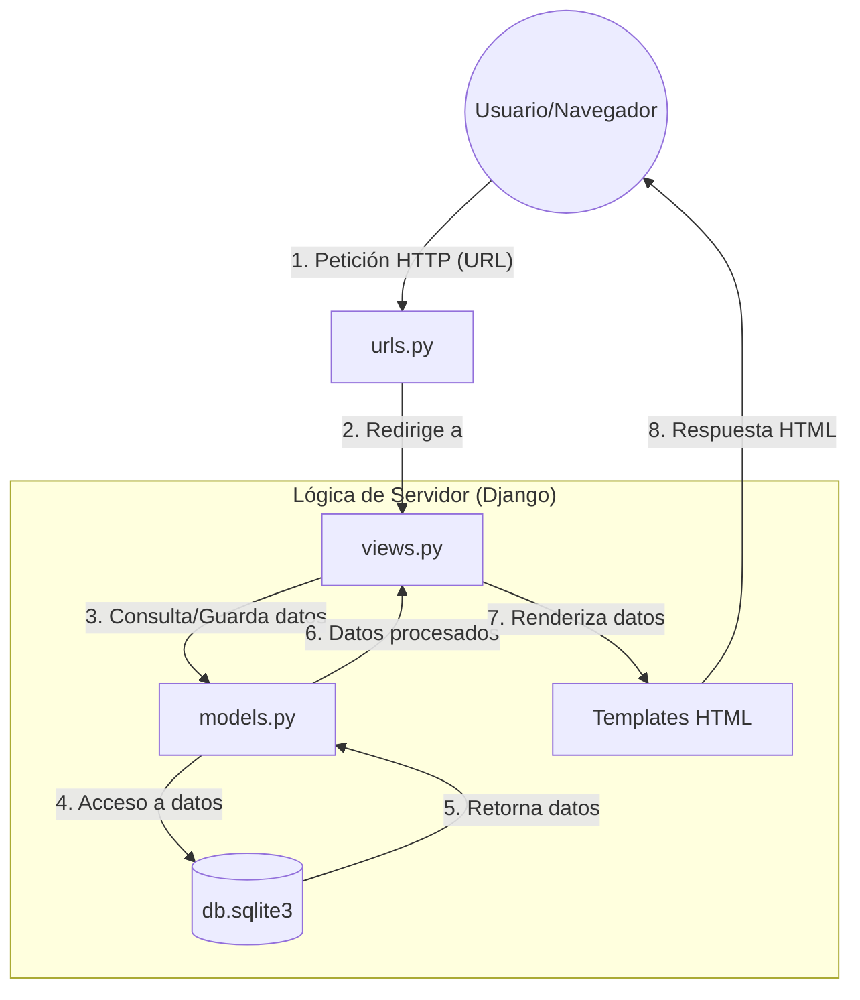

# Página Web Store (TecStore)

Tienda virtual de periféricos gamer hecha con **Django**. Incluye catálogo, carrito, compra, cuenta de cliente y un panel de administración, con los datos guardados en una base de datos SQLite.

Proyecto de la Evaluación Integrada PTEC103 (Desarrollo Web y Móvil).
Repositorio: https://github.com/ennisvaleria/pagina-web-Store

## Qué incluye

**Cliente**
- Registro e inicio de sesión (las contraseñas se guardan cifradas).
- Catálogo de productos leído desde la base de datos, con buscador.
- Carrito y botón **Finalizar compra**, que crea el pedido y descuenta el stock.
- **Mis pedidos**: historial de compras.
- **Mi perfil**: ver y editar datos, cambiar la contraseña y eliminar la cuenta.

**Administrador**
- Panel en `/panel/` con CRUD de **productos** (con imagen, buscador y filtro por categoría) y de **categorías**.
- Listado de **pedidos** con detalle y cambio de estado.
- Listado de **clientes** y eliminación de cuentas.

**API (JSON)**
- `/api/productos` lista los productos; con `?q=texto` filtra por nombre o descripción.
- `/api/usuario` entrega los datos del cliente con sesión activa (sin la contraseña).

## Requisitos

- **Python 3.12 o superior** (Django 6 no funciona con versiones anteriores).
- **Git**.
- Paquetes de Python: `django` y `pillow` (Pillow es necesario por las imágenes de los productos).

## Cómo ejecutar el proyecto

Los comandos están pensados para **Windows (PowerShell)**; al final de cada bloque se indica la diferencia en Linux/macOS.

**1. Descargar el proyecto**

```powershell
git clone https://github.com/ennisvaleria/pagina-web-Store.git
cd pagina-web-Store
```

**2. Crear y activar el entorno virtual**

```powershell
py -m venv venv
Set-ExecutionPolicy -Scope Process Bypass
.\venv\Scripts\Activate.ps1
```

Debe aparecer `(venv)` al inicio de la línea. En Linux/macOS: `python3 -m venv venv` y `source venv/bin/activate`.

**3. Instalar las dependencias**

```powershell
python -m pip install django pillow
```

**4. Crear la base de datos y el administrador**

Define la contraseña del administrador (la eliges tú; no está guardada en el repositorio) y ejecuta las migraciones:

```powershell
$env:ADMIN_INITIAL_PASSWORD = "TuClaveSegura"
python manage.py migrate
```

En Linux/macOS: `export ADMIN_INITIAL_PASSWORD="TuClaveSegura"`.

Al migrar se crea la cuenta **admin@tienda.cl** con esa contraseña (solo si todavía no existe un administrador). Si prefieres no usar la variable, ejecuta `python manage.py migrate` y luego `python manage.py crear_admin`, que pide la contraseña por pantalla.

**5. Cargar las categorías y los productos de ejemplo**

```powershell
python manage.py loaddata datos_iniciales.json
```

Carga 4 categorías y 8 productos.

**6. Iniciar el servidor**

```powershell
python manage.py runserver
```

Abre **http://127.0.0.1:8000/** en el navegador. Para detener el servidor, presiona `Ctrl + C`.

## Credenciales de prueba

| Rol | Correo | Contraseña |
|---|---|---|
| Administrador | `admin@tienda.cl` | la definida en `ADMIN_INITIAL_PASSWORD` (o en `crear_admin`) |
| Cliente | el que registres en la página | la que elijas (mínimo 6 caracteres) |

Un cliente se crea desde el botón **Registrarse** del login. Todo usuario nuevo es cliente; solo el administrador puede entrar al panel.

## Cómo probar el flujo completo

1. **Registro:** en http://127.0.0.1:8000/ pulsa *Registrarse*. Si envías el formulario vacío o con datos inválidos, aparecen los errores bajo cada campo.
2. **Inicio de sesión:** entra con el correo y la contraseña. Con datos incorrectos aparece un mensaje de error.
3. **Compra:** en la tienda agrega productos al carrito y pulsa *Finalizar compra*. El pedido aparece en *Mis pedidos*.
4. **Perfil:** desde el menú del usuario, entra a *Mi perfil* y edita tus datos o cambia la contraseña.
5. **Administración:** cierra sesión y entra como `admin@tienda.cl`. Desde el panel crea, edita y elimina productos y categorías, revisa el pedido y cambia su estado.
6. **API:** abre http://127.0.0.1:8000/api/productos y http://127.0.0.1:8000/api/usuario.

## Rutas principales

| Zona | Ruta | Descripción |
|---|---|---|
| Cliente | `/` | Inicio de sesión y registro |
| Cliente | `/principal` | Tienda y carrito |
| Cliente | `/perfil` | Mi perfil |
| Cliente | `/mis-pedidos` | Historial de pedidos |
| Cliente | `/checkout` | Finalizar compra (la usa el botón del carrito) |
| Admin | `/panel/` | Panel de administración |
| Admin | `/panel/productos/` | CRUD de productos |
| Admin | `/panel/categorias/` | CRUD de categorías |
| Admin | `/panel/pedidos/` | Pedidos y cambio de estado |
| Admin | `/panel/clientes/` | Clientes |
| API | `/api/productos` | Lista de productos (JSON) |
| API | `/api/usuario` | Usuario con sesión activa (JSON) |

## Estructura del proyecto

```
manage.py
datos_iniciales.json      categorías y productos de ejemplo
config/
  models.py               Categoria, Producto, Cliente, Pedido, DetallePedido
  views.py                login, registro, tienda y API
  views_cuenta.py         Mi perfil
  views_pedidos.py        compra, mis pedidos y pedidos/clientes del panel
  views_admin.py          panel de productos y categorías
  decorators.py           @admin_requerido y @cliente_requerido
  forms*.py               formularios y validaciones
  urls.py                 rutas
  templates/              páginas HTML
  static/                 CSS, JavaScript e imágenes
  management/commands/    comando crear_admin
media/productos/          imágenes de los productos subidas desde el panel
```

## Pruebas automáticas

```powershell
python manage.py test
```

## Respaldo de la base de datos

Para generar un respaldo de los datos:

```powershell
python manage.py dumpdata config --indent 2 --output respaldo.json
```

Y para restaurarlo en una base de datos nueva (después de `migrate`):

```powershell
python manage.py loaddata respaldo.json
```

Usa `--output` y no el símbolo `>`: en PowerShell `>` guarda el archivo en UTF-16 y después no se puede restaurar.

## Solución de problemas

| Problema | Solución |
|---|---|
| `Cannot use ImageField because Pillow is not installed` | Con el entorno activo: `python -m pip install pillow`. |
| `la ejecución de scripts está deshabilitada` al activar el entorno | Ejecuta `Set-ExecutionPolicy -Scope Process Bypass` y vuelve a activarlo. |
| `python no se reconoce` o abre la Microsoft Store | Instala Python desde python.org marcando *Add python.exe to PATH*, o usa `py` en lugar de `python`. |
| El administrador dice "Correo o contraseña incorrectos" | El administrador no existe en tu base de datos. Define `ADMIN_INITIAL_PASSWORD` y ejecuta `python manage.py migrate`, o ejecuta `python manage.py crear_admin`. |
| El catálogo está vacío | Falta cargar los datos: `python manage.py loaddata datos_iniciales.json`. |
| Algunos productos no muestran imagen | Las imágenes están en `config/static/images/`. Cópialas a `media/productos/` (`Copy-Item config\static\images\* media\productos\`) o súbelas de nuevo desde el panel. |
| `Port is already in use` | Ya hay un servidor corriendo. Ciérralo o usa otro puerto: `python manage.py runserver 8001`. |

Cada persona trabaja con su **propia** base de datos local (`db.sqlite3` no se sube al repositorio), por eso el administrador y los clientes de prueba hay que crearlos en cada computador.

## Arquitectura del sistema

La aplicación sigue el patrón **MVT (Model-View-Template)** de Django.

### Diagrama de arquitectura



### Descripción de los componentes

1.  **Usuario/Navegador**: El cliente que interactúa con la interfaz web enviando solicitudes.
2.  **URLs (`urls.py`)**: Actúa como el despachador de peticiones. Mapea la dirección solicitada con la función de vista correspondiente.
3.  **Vistas (`views.py`)**: Contiene la lógica de negocio. Recibe la petición, interactúa con los modelos y determina qué plantilla mostrar.
4.  **Modelos (`models.py`)**: Define la estructura de los datos y actúa como interfaz entre la lógica de Django y la base de datos.
5.  **Base de Datos (`db.sqlite3`)**: Almacén persistente de la información del sistema.
6.  **Plantillas (`Templates`)**: Archivos HTML que definen cómo se presenta la información al usuario final.

### Flujo de datos
El flujo es cíclico: **Usuario** $\rightarrow$ **URL** $\rightarrow$ **Vista** $\rightarrow$ **Modelo** $\rightarrow$ **DB** $\rightarrow$ **Modelo** $\rightarrow$ **Vista** $\rightarrow$ **Template** $\rightarrow$ **Usuario**.

## Administrador y despliegue

El login y el registro usan el modelo `Cliente`. El administrador inicial se crea al ejecutar las migraciones si se configuró la variable de entorno `ADMIN_INITIAL_PASSWORD`; `ADMIN_INITIAL_EMAIL` permite cambiar el correo (por defecto `admin@tienda.cl`). Si ya existe un administrador, no se modifica.

Al preparar Docker Compose, el servicio debe proporcionar `ADMIN_INITIAL_PASSWORD` y ejecutar `python manage.py migrate` antes de iniciar el servidor.
