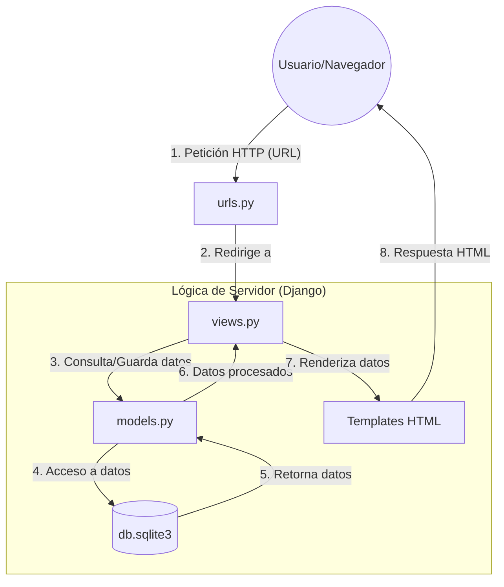

# Arquitectura del Sistema - Página Web Store

Este documento describe la arquitectura implementada en el proyecto, basada en el patrón **MVT (Model-View-Template)** de Django.

## Diagrama de Arquitectura

## Descripción de los Componentes

1.  **Usuario/Navegador**: El cliente que interactúa con la interfaz web enviando solicitudes.
2.  **URLs (`urls.py`)**: Actúa como el despachador de peticiones. Mapea la dirección solicitada con la función de vista correspondiente.
3.  **Vistas (`views.py`)**: Contiene la lógica de negocio. Recibe la petición, interactúa con los modelos y determina qué plantilla mostrar.
4.  **Modelos (`models.py`)**: Define la estructura de los datos y actúa como interfaz entre la lógica de Django y la base de datos.
5.  **Base de Datos (`db.sqlite3`)**: Almacén persistente de la información del sistema.
6.  **Plantillas (`Templates`)**: Archivos HTML que definen cómo se presenta la información al usuario final.

## Flujo de Datos
El flujo es cíclico: **Usuario** $\rightarrow$ **URL** $\rightarrow$ **Vista** $\rightarrow$ **Modelo** $\rightarrow$ **DB** $\rightarrow$ **Modelo** $\rightarrow$ **Vista** $\rightarrow$ **Template** $\rightarrow$ **Usuario**.
